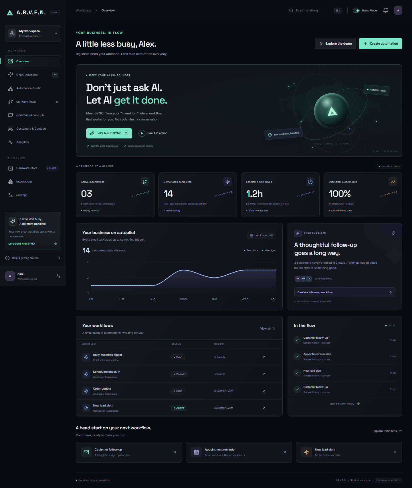

# A.R.V.E.N. — your business, in flow

**Don’t Just Ask AI. Let AI Get It Done.**

A working, single-user local MVP of an AI automation workspace for small businesses. SYNO turns an instruction into an editable workflow. A local execution engine records simulated messages, persistent logs, schedules, and failures in SQLite. The founder showcase works without an API key or paid service.



## Quick start

Use **Node.js 22.12+** (Node 24 recommended) and npm. From PowerShell:

```powershell
cd C:\Users\hppc\A.R.V.E.N\A.R.V.E.N
npm.cmd install
npm.cmd run setup
npm.cmd run dev
```

On macOS/Linux, use `npm` instead of `npm.cmd`. The `.cmd` form avoids Windows PowerShell execution-policy restrictions; no policy changes are required.

Open **<http://127.0.0.1:5173>**. Vite proxies `/api` to Express on loopback port 3001. The first install/setup needs internet access to download packages and Prisma's platform engine. After that, Demo Mode works offline with locally bundled fonts and illustrations.

`setup` creates `.env` with safe defaults if missing, generates Prisma Client, pushes the schema, and creates the sample workspace only if one does not exist. Running setup again preserves existing business data. Use **Settings → Reset demo data** for a confirmed, intentional reset. `npm run db:seed` is the explicit command-line reset and replaces sample/business data.

### Production build, served locally

```powershell
npm.cmd run build
npm.cmd start
```

Open **<http://127.0.0.1:3001>**. Express serves both the compiled React app and API. This is the recommended screen-recording mode because it avoids development hot reload. Stop with Ctrl+C.

This MVP intentionally binds to loopback. It is not a production, multi-user hosting configuration.

## Try the complete showcase

1. On Overview, click **Explore the demo** and **Start the showcase**.
2. Send the prefilled instruction: **“Remind customers who haven't replied in three days.”**
3. Click **Review in Studio**. Inspect the recipient, condition, and message.
4. Choose **Review & activate**, then **Approve & activate**.
5. Click **Trigger sample event** in the guide bar.
6. Inspect the persistent execution log, then view the personalized follow-up in Communication Hub.
7. Visit Analytics: local success and message counts each increase by one. Reload to demonstrate persistence.

All workflow messages are labeled **Demo — Not Sent**. The hardware store is a **Concept Store — Not Yet Available**. It processes no real orders or payments.

See [the full demo guide](docs/DEMO.md) for repeatable instructions, a two-minute recording sequence, recovery scenarios, and five recommended screenshots. See [capabilities and limitations](docs/CAPABILITIES.md) for the complete, explicit feature inventory.

## Included

- Ten functioning pages: Overview, SYNO, Automation Studio, My Workflows, Communication Hub, Customers & Contacts, Analytics, Hardware Store, Integrations, and Settings.
- Seven SYNO intent families and templates; clarification for unsupported instructions; persisted chat; optional real AI proposals.
- React Flow editing with saved node positions, triggers, conditions, delays, recipient scope, and four communication channels.
- Workflow create/edit/save/duplicate/test/delete, approval, activation/pause, sample events, recurring schedules, logs, cancellation, failure simulation, and retries.
- CRM with notes, tags, lead status, follow-up dates, interaction history, CSV import/upsert, and safe CSV export. Due follow-up reminders create local notification records once.
- Conversation tabs, local message composition, scheduling, follow-up cancellation, and honest status labels.
- Recharts analytics from the local database. Seeded history is labeled; estimated time savings are clearly identified.
- Five illustrated hardware concepts, category filters, persistent cart, product detail URLs, working quantity/totals, and checkout preview.
- Responsive dark interface, Motion transitions, keyboard search, visible focus states, modal focus containment, reduced-motion support, and persistent preferences.

## Environment configuration

`.env.example` lists every supported variable. Secrets stay in `.env`, which Git ignores. No provider key is exposed in frontend state or bundled source.

| Variable | Default / purpose |
| --- | --- |
| `DATABASE_URL` | `file:./dev.db`, relative to `database/schema.prisma`; persisted database at `database/dev.db`. |
| `PORT` | `3001`. The Vite proxy expects this default. If changed, update the proxy in `vite.config.ts`. |
| `HOST` | `127.0.0.1`. Only loopback hosts are accepted. |
| `OPENROUTER_API_KEY` | Private backend key. Enables selecting AI Mode and testing the connection in SYNO. |
| `OPENROUTER_BASE_URL` | `https://openrouter.ai/api/v1`. Other hosts are rejected before sending credentials. |
| `OPENROUTER_MODEL` | Read from private `.env`; defaults to `nvidia/nemotron-3-ultra-550b-a55b` when empty. The configured identifier is used exactly, without automatic alternate-model or `:free` substitution. |
| `TWILIO_ACCOUNT_SID` | Optional, server-side live SMS account SID. |
| `TWILIO_AUTH_TOKEN` | Optional, server-side Twilio token. |
| `TWILIO_FROM` | Optional, authorized sender number. |
| `ENABLE_LIVE_SMS` | `false`. Set `true` only when intentionally configuring the individual live SMS adapter. |

### Optional real AI

SYNO reads `OPENROUTER_API_KEY`, `OPENROUTER_MODEL`, and `OPENROUTER_BASE_URL` from the private backend `.env`. The current configuration uses **NVIDIA Nemotron 3 Ultra through OpenRouter**, with model ID `nvidia/nemotron-3-ultra-550b-a55b`. The example file contains empty OpenRouter placeholders and comments describing public defaults. Restart the backend after editing private configuration, then choose **AI Mode** inside SYNO. `OPENAI_API_KEY` is not used by this client. Never prefix a secret with `VITE_`.

The backend calls `https://openrouter.ai/api/v1/chat/completions` with [strict JSON-schema structured outputs](https://openrouter.ai/docs/guides/features/structured-outputs), restricts routing to providers that support the required parameters, and validates the result again with Zod. It permits one supported action and exposes no execution tools or database access. Recipient IDs are selected locally. AI Mode sends your instruction to OpenRouter and may incur provider charges. Workflow actions always remain simulated.

Click **Test connection** in SYNO or run `npm.cmd run ai:test`. Both use the same backend adapter and a synthetic instruction, validate the returned workflow, and execute no business action. Test output contains only public provider/model metadata and sanitized results. A live connection to the exact model was verified on 29 October 2026. Automated tests use fake credentials and mocked provider responses instead of the private key.

Missing or invalid keys, insufficient credits, unavailable model endpoints, unsupported structured outputs, rate limits, network failures, timeouts, malformed JSON, and invalid proposals produce distinct errors. Provider error text, raw headers, and credentials are never forwarded to the browser or logged. There is no automatic model fallback or automatic retry that could silently add provider charges.

### Optional individual live SMS

Configure the Twilio variables and restart. In Integrations, open **Twilio SMS → Verify server connection**. Only a successfully authorized active account is labeled Connected.

Create a demo SMS in Communication Hub for a contact whose consent is recorded. **Review live SMS** shows the exact message and phone number. Approve that one message by typing the final four phone digits. The route has a five-message hourly limit. Workflows never use live SMS. A provider-accepted message is not labeled delivered; **Check delivery** reads the [official provider status](https://www.twilio.com/docs/messaging/api/message-resource). An ambiguous send outcome is recorded as unconfirmed and is not automatically retried.

The exact OpenRouter model connection was tested successfully with the private backend key. Twilio authorization and delivery remain **untested with live credentials**. Gmail OAuth, live email, WhatsApp Business authorization/sending, Google Calendar OAuth, public webhooks, multi-user hosting, and actual hardware are **incomplete future capabilities**, accurately labeled in the app. External messaging stays disabled by default (`ENABLE_LIVE_SMS=false`); configuring AI does not enable it.

Seeded fictional contacts are blocked from live SMS even if they have a sample consent flag. Create your own contact with a real authorized number and recorded consent to use the optional live path.

## Architecture

```text
frontend/                React, TypeScript, Tailwind CSS, Motion, Lucide
  pages/                 Ten application screens; React Flow and Recharts
  App.tsx                Navigation, workspace state, modals, guided showcase
  api.ts                 Same-origin API client and local session handling
backend/
  app.ts                 Express API, validation, local access boundaries
  engine.ts              Serialized durable local workflow scheduler
  integrations/          Local parser, OpenRouter/Nemotron client, optional Twilio
  db.ts                  Prisma client and serialized-field adapters
database/
  schema.prisma          Contact, Workflow, Execution, Message, Preference, ChatMessage
  seed.ts                Transactional, repeatable fictional showcase data
shared/                  Zod contracts, types, templates, CSV handling
scripts/setup.ts         Non-destructive local setup
tests/                   Vitest integration tests and Playwright browser tests
docs/                    Capabilities, demo instructions, actual screenshots
```

The graph is an editable, validated sequence: **Trigger → Condition → Delay → Action**. It intentionally does not execute arbitrary graph branches or code. Workflow changes return to draft and require approval again. Executions snapshot their definitions; an already-created delayed run retains its snapshot until explicitly cancelled.

The one-second scheduler runs only while Express is running. Schedules, delays, and queued work are persisted. Overdue recurring schedules coalesce into one execution after restart; the engine does not replay every missed interval. Runs have a maximum of ten recipients and one action. Retrying a failed run preserves its ID and log and avoids repeating an already-recorded action. Only one backend process should own a database.

## Validation and tests

```powershell
npm.cmd run typecheck
npm.cmd test
npm.cmd run test:e2e
npm.cmd run build
```

Tests use **separate databases**: `database/test.db` for API/engine tests and `database/browser.db` for browser tests. They do not reset `database/dev.db`.

The browser configuration uses installed Chrome on Windows when found. On other systems, install the test browser once with `npx playwright install chromium`. Close other instances of this app before browser tests: the tests own ports 5173 and 3001 and deliberately do not reuse an existing server. Browser tests regenerate the screenshot set in `docs/screenshots/`.

API tests cover all supported parser intents, invalid input, session and origin checks, explicit approval, workflow persistence, event matching, delayed resumption/cancellation, simulated failure/retry, scheduled runs, contact reminders, messages, CSV safety, preferences, and reset. Browser tests cover all pages, the guided end-to-end demo, mobile overflow, customer edits, message composition/scheduling, cart totals, keyboard search, modal behavior, settings, and reset.

To run the same browser suite against the compiled production app in PowerShell:

```powershell
npm.cmd run build
$env:ARVEN_TEST_PRODUCTION='true'
npm.cmd run test:e2e
Remove-Item Env:ARVEN_TEST_PRODUCTION
```

## Local access and data boundaries

This is a trusted single-owner local prototype. It uses an in-memory session token, same-origin/host checks, rate limits, bounded JSON input, Zod validation, and Prisma queries. It has no production user authentication, organization roles, or internet deployment. Do not expose the server through a tunnel or bind it to a public interface. The session rotates on restart; reload the browser if a restart interrupts a request.

The interface retrieves the latest 200 messages and 100 executions; metric totals include all database records. CSV imports accept up to 100 contacts/120 KB and default consent to false. Contact exports neutralize spreadsheet formula payloads. Hardware carts persist in browser local storage, separately from demo data.

## Troubleshooting

- **PowerShell blocks npm.ps1:** use `npm.cmd`, as shown above.
- **Prisma cannot initialize a new SQLite file on Windows:** `npm run setup` pre-creates the file before applying the schema. It is safe to repeat.
- **Missing generated Prisma Client:** run `npm run setup` after installing dependencies. This also works when your package manager blocks dependency postinstall scripts.
- **The frontend cannot reach the backend:** run both using `npm run dev`, verify port 3001 is free, then reload. With the production build, use `npm start` and port 3001 directly.
- **Vite reports port 5173 in use:** stop the previous app process or browser test. The server uses a strict port to keep the proxy, local access rules, and test URLs predictable.
- **An integration is Not Connected:** this is expected without verified provider credentials. The local demo alternative works immediately.
- **A workflow produces no messages:** inspect the execution log; selected recipients must also satisfy its condition. A no-match execution is labeled skipped.
- **A schedule did not run while the app was closed:** keep the backend running; this MVP has no cloud scheduler.

The project has no payment processor, tracking scripts, externally hosted fonts, or required external services in Demo Mode.
